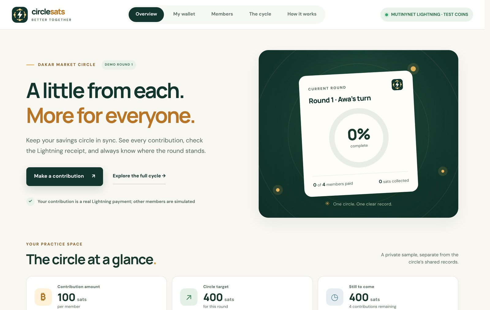
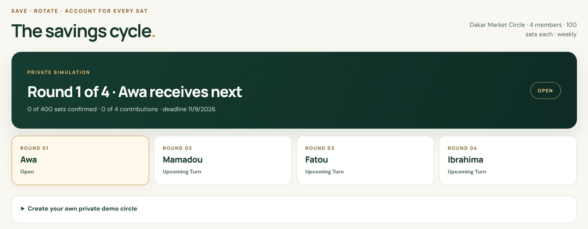
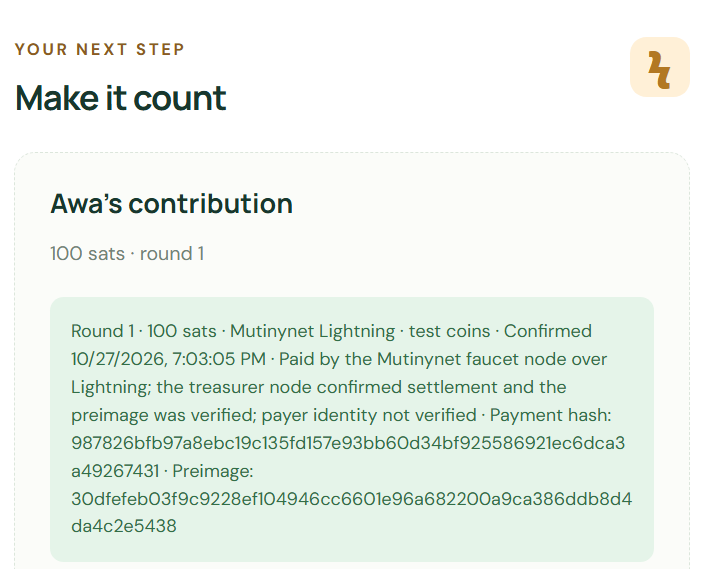
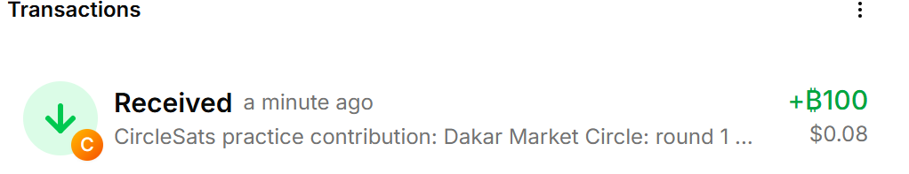
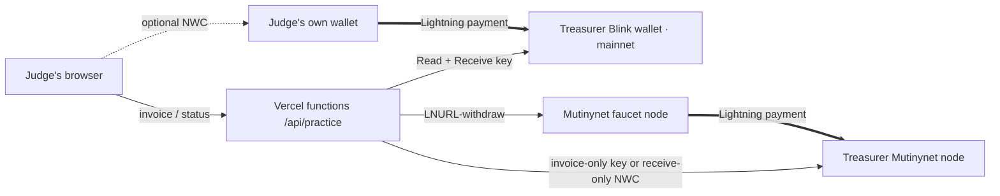

<p align="center">
  
</p>

<h1 align="center">CircleSats</h1>

<p align="center">
  <b>Save together. Pay instantly. Rotate fairly. Track every sat.</b><br>
  Rotating savings circles (<i>tontines</i>, <i>natt</i>) on Bitcoin Lightning · Dakar Bitcoin Hack 2026
</p>

<p align="center">
  <a href="https://circlesats-two.vercel.app"><b>Try the live demo</b></a> ·
  <a href="#verified-lightning-payment-27-october-2026">Payment evidence</a> ·
  <a href="#hackathon-requirements">Requirements</a>
</p>

<p align="center">
  
  
  
  
</p>



## Why CircleSats

In Senegal and across West Africa, many people save in rotating circles: every member pays the same amount each week or month, and one member takes the whole pot each turn. They run on trust and memory, so nobody has one clear record of who has paid, shortfalls are found late, payouts are argued over, and members abroad struggle to pay in.

CircleSats keeps the circle the way people already run it and adds one shared, verifiable record:

- **Contribute over Lightning.** Each member gets a unique invoice for the round. It counts only when the treasurer's wallet confirms it, and the receipt shows the payment hash and preimage so anyone can check it.
- **See the round at a glance:** who has paid, who is due or late, the target and the deadline.
- **Approve the payout together.** Every member except the recipient approves, and the recipient cannot approve their own payout. Every action goes into an audit trail.
- **Rotate fairly.** The order is fixed in advance, and history is kept across cycles.
- **Never hold the pot.** CircleSats has receive-only access to the treasurer's wallet and cannot spend from it.



## Verified Lightning payment (27 October 2026)

Through the live public demo, Awa's round-1 contribution was paid over Lightning. The Mutinynet faucet's node paid a 100-sat invoice issued by the circle treasurer's node. The treasurer node confirmed it, and the preimage matched the payment hash. **This is a real Lightning payment on Mutinynet, a public Bitcoin test network, so the coins have no market value.**

<table>
  <tr>
    <td width="50%" valign="top"><br><sub>The CircleSats receipt on the live demo (time shown in UTC+1).</sub></td>
    <td width="50%" valign="top"><br><sub>The treasurer's own wallet (Alby Hub) received the 100 sats. These are test coins; the dollar figure is Alby Hub's display conversion.</sub></td>
  </tr>
</table>

| Detail | Value |
| --- | --- |
| **Network** | Mutinynet (Bitcoin signet); invoice prefix `lntbs` |
| **Amount** | 100 sats |
| **Invoice created / paid** | 18:02:54 UTC / 18:03:05 UTC on 27 October 2026 |
| **Memo** | CircleSats practice contribution: Dakar Market Circle: round 1 - Awa |
| **Payer** | Mutinynet faucet, through its public LNURL-withdraw service |
| **Payee (treasurer node)** | `024c3d2049e815d69811d043273e33eb6bb3840dc95246acc5066cf16f2de962da` |
| **Payment hash** | `987826bfb97a8ebc19c135fd157e93bb60d34bf925586921ec6dca3a49267431` |
| **Preimage** | `30dfefeb03f9c9228ef104946cc6601e96a682200a9ca386ddb8d4da4c2e5438` |
| **Server logs** | `invoice` 201 at 18:02:54Z, then `pay` 200 `settled` at 18:03:05Z (3.3 s) |

**Check it yourself.** A Lightning payment reveals its preimage only when it completes, and the SHA-256 of the preimage must equal the payment hash:

```bash
python3 -c "import hashlib; print(hashlib.sha256(bytes.fromhex('30dfefeb03f9c9228ef104946cc6601e96a682200a9ca386ddb8d4da4c2e5438')).hexdigest())"
# 987826bfb97a8ebc19c135fd157e93bb60d34bf925586921ec6dca3a49267431
```

The full invoice is in the [payment evidence record](docs/LIGHTNING_PAYMENT_EVIDENCE.md). Paste it into any BOLT11 decoder to see the amount, memo, payee and the same payment hash. Lightning payments have no per-payment on-chain transaction, so there is no block-explorer link for the payment itself.

## Try it in one minute

No sign-up. Each visitor gets a private circle, so judges never see or affect each other's payments.

1. Open **[circlesats-two.vercel.app](https://circlesats-two.vercel.app)** → **Start guided demo** → **Create demo wallet** → **Get 200 demo sats for this round**.
2. **Go to my contribution** → **Create demo contribution**.
3. Pay it:
   - **With a Lightning wallet** (header shows **BITCOIN LIGHTNING · REAL SATS**): scan the QR code, copy the `lnbc…` invoice, or connect your wallet with **Nostr Wallet Connect** and pay 100 sats inside the page. CircleSats detects the payment by itself. This is a real Bitcoin payment and is not refunded.
   - **Without a wallet:** tap **No Lightning wallet? Use free test coins** (or, if the header already shows **MUTINYNET LIGHTNING · TEST COINS**), then **Pay with demo wallet**. The Mutinynet faucet pays a test-coin invoice over Lightning for you, in up to a minute.
4. Check the receipt. It keeps the **paid invoice**: decode it with any BOLT11 decoder to see the circle's node as the payee and the same **payment hash**. SHA-256 of the **preimage** equals that hash.
5. **Simulate** the other three members' payments, approve, and watch the payout rotate through all four rounds in **The savings cycle**.

## Hackathon requirements

| Requirement | Where to see it |
| --- | --- |
| Bitcoin / Lightning solution for a local need | Rotating savings circles (*tontines*, *natt*) on Lightning, with the seeded Dakar Market Circle. See [Why CircleSats](#why-circlesats). |
| Nostr | Nostr Wallet Connect (NIP-47): judges can connect their own wallet and pay inside the demo, and a treasurer node such as Alby Hub can receive over a receive-only NWC connection. |
| At least a Bitcoin/Lightning wallet implementation | Lightning invoices (receive), in-app NWC payment (send), practice wallets with balances, and the [verified payment](#verified-lightning-payment-27-october-2026) above. |
| Presentation (text or video) | Submitted with the Devpost entry |
| Prototype / MVP | [circlesats-two.vercel.app](https://circlesats-two.vercel.app) (no sign-up) and the full Node app in this repository |
| AI | Not used; the brief's examples show Bitcoin-only solutions also qualify. |

## How it works



Every payment mode is labelled on screen and on the receipt:

| Label | Who pays | What it proves |
| --- | --- | --- |
| **BITCOIN LIGHTNING · REAL SATS** | The judge's own wallet pays the treasurer's Blink wallet | A real Bitcoin payment. Available once the operator adds the Blink key. |
| **MUTINYNET LIGHTNING · TEST COINS** | The Mutinynet faucet pays the treasurer's node | A real Lightning payment with test coins ([verified](#verified-lightning-payment-27-october-2026)) |
| **ALBY SANDBOX · TEST SATS** | One private sandbox wallet pays another | The NWC flow only; not routed over a Lightning network |
| **SIMULATED SATS** | Nobody | A walkthrough of the app only |

If a mode is unavailable, the demo falls back to the next one automatically.

**Security at a glance**

- Receive-only credentials, checked before use: a Blink key with Write, an NWC connection with `pay_invoice`, or an LND macaroon that could pay or manage the node is refused.
- A payment counts only when the receiving wallet reports that exact invoice, hash and amount as settled. The preimage is checked on the server and again in the browser.
- The faucet is asked to pay only pending, unexpired 100-sat invoices that the treasurer itself issued, so the demo cannot be used to send coins anywhere else. Each visitor gets at most 8 test-coin payments an hour and 12 a day, and simultaneous requests for one invoice share one payment, so nobody can use up the shared faucet allowance.
- Unique payment hashes, CSRF-protected sessions, a strict Content Security Policy, rate limits, and no secrets in the browser or in Git.

More detail: [architecture](docs/ARCHITECTURE.md), [security boundaries](docs/SECURITY.md), [savings-cycle rules](docs/SAVINGS_CYCLE.md).

## Run it locally

Node.js 24+:

```bash
npm install
npm start          # http://localhost:3100 → Start guided demo
```

Verify:

```bash
npm test                 # 58 tests: the four-round cycle, payment matching, replay and mismatch cases, forged proofs, abuse limits, every payment path
npm run build
npm run check:secrets
npm run build:vercel && npm run preview:vercel   # the public demo at http://127.0.0.1:3200
```

The 58 tests last passed on 27 October 2026 on Node 22, with dependencies rebuilt from their upstream sources because the npm registry was unreachable. Rerun `npm ci && npm test` on Node 24 before a release.

<details>
<summary><b>Operator setup for real payments on the public demo</b></summary>

**Real sats (mainnet):** create a free [Blink](https://dev.blink.sv/api/auth) account and, at dashboard.blink.sv → API Keys, a key with only **Read** and **Receive** (CircleSats refuses a key with Write). Add it to the Vercel project as the sensitive variable `BLINK_RECEIVE_API_KEY` (Production and Preview) and redeploy. `/api/practice/info` then reports `rails.mainnet.available: true`. Set `PRACTICE_MAINNET=0` to turn real-sat invoices off. Blink is hosted, so this mode does not depend on your PC being online.

**Test coins (Mutinynet), always online (recommended):** use a hosted LND node on Mutinynet, for example on [Voltage](https://voltage.cloud)'s free Essentials plan, so the treasurer does not depend on your PC.

1. Create a Mutinynet LND node and finish Voltage's setup prompts.
2. Give it incoming capacity: at [faucet.mutinynet.com](https://faucet.mutinynet.com), open a Lightning channel **to** the node (paste its `pubkey@host:9735` connection address). 100,000 sats covers about 1,000 payments. Mutinynet blocks are about 30 seconds, so the channel is usable within minutes.
3. Copy the node's REST API address (`https://…`) and its **invoice** macaroon in hex. Never use the admin macaroon: CircleSats reads the macaroon's permissions and refuses one that could pay, send coins or manage the node.
4. In the Vercel project's environment variables, add `LND_REST_URL` and the sensitive `LND_INVOICE_MACAROON` (Production and Preview), then redeploy. If the node asks for an API IP allowlist, allow all addresses: Vercel has no fixed address, and the invoice macaroon cannot spend.

**Test coins with your own Alby Hub (alternative):** set `NWC_RECEIVER_CONNECTION_SECRET` to the Hub's **receive-only** NWC connection (`make_invoice` and `lookup_invoice`, no `pay_invoice`; startup refuses spending permission), plus `PAYMENT_ENVIRONMENT=signet` and `LNBITS_NETWORK=signet`. The Hub must stay online with incoming capacity (each payment needs 100 sats). When both are set, the LND node is used.

For either: `/api/practice/info` then reports `rails.signet.available: true`. Set `PRACTICE_LIGHTNING=0` to turn test-coin payments off. If the node is unreachable, the demo answers within seconds and judges get the labelled Alby sandbox or simulation instead.

- The faucet allows about 60 withdraw requests and 1,000,000 sats per server address per day.
- Test locally before deploying: with your private `.env.mutinynet` in place, run `npm run build:vercel` then `npm run preview:vercel` and open http://127.0.0.1:3200. The local preview loads the same receiver connection and calls the faucet from your own internet address.

</details>

<details>
<summary><b>The full Node app: member access, receivers and the shared ledger</b></summary>

The Vercel site is a **browser-only guided demo**. It runs the same savings-cycle rules in each visitor's tab: the visitor's own contribution uses the payment modes above, while other members, approvals and payouts are simulated, and nothing is shared between visitors. The full Node app below is required for member access and a shared ledger. It needs one persistent host and must not run on Vercel's temporary filesystem.

Open [localhost:3100](http://localhost:3100), choose **Start guided demo**, and open **The savings cycle**. Simulate each member's contribution, record the three approvals from members other than the recipient, then select **Simulate payout & open next round**. Repeat for all four recipients. The final screen keeps each round's receipts, approvals and simulated settlement; **Start another cycle** keeps the history. A private guest can also configure a 2–8 member weekly or monthly group before its first contribution. The guest ledger lives only in that server session and never changes the shared group. Set `GUEST_LIGHTNING_SANDBOX=0` to keep guests fully simulated.

Members of the shared group sign in with organizer-issued access codes. Local development prints codes once; production requires `npm run provision:members`, which writes them to a private file outside the source tree and keeps them out of server logs. Only salted hashes are kept for login. Demo mode also offers an in-app wallet and a per-round allotment of **simulated** sats that cannot leave CircleSats.

**Receivers.** The server receives contribution invoices through either **LNbits** or a **receive-only Nostr Wallet Connect (NWC)** connection. Both adapters create an invoice and independently check settlement, amount and invoice identity before crediting a member's round. The receiver secret stays on the server. A member can copy an invoice to any Lightning wallet, or connect a separate, small-budget NWC **payer** in their browser. Payment from that wallet may provide a preimage, which CircleSats checks against the hash to link the payment to the signed-in account. A receiver-confirmed payment without that proof is marked **payer unverified**. An access code and preimage do not establish a person's legal identity.

**Payouts.** The seeded group records confirmed contributions, payout eligibility, approvals by every nonrecipient member, and a manual transfer reference, which is explicitly **unverified**. Real Lightning mode does not execute or independently verify payouts, so a real round cannot be marked complete from a treasurer's claim alone. Completing the full rotation is available only in the clearly marked simulation.

To configure a receiver, copy `.env.example` to a local `.env` and choose one provider:

```dotenv
LIGHTNING_PROVIDER=lnbits
PAYMENT_ENVIRONMENT=signet
LNBITS_URL=https://your-instance.example
LNBITS_INVOICE_KEY=your-receive-only-invoice-key
LNBITS_NETWORK=signet
```

or:

```dotenv
LIGHTNING_PROVIDER=nwc
PAYMENT_ENVIRONMENT=signet
NWC_RECEIVER_CONNECTION_SECRET=nostr+walletconnect://your-receive-only-connection
LNBITS_NETWORK=signet
```

The NWC receiver requires `get_info`, `make_invoice` and `lookup_invoice` and normally rejects `pay_invoice`. Never use a spending or admin key for receiving. The payer wallet needs `pay_invoice` and a small budget; its NWC URI is entered in the browser at runtime, stays in that tab's memory and can be disconnected. No wallet URI is bundled into public assets. Keep both secrets out of Git, screenshots and chat, and restart the app after changing `.env`. See [testnet setup](docs/TESTNET_SETUP.md) and [Lightning integration](docs/LIGHTNING_INTEGRATION.md).

**Mutinynet acceptance test for the Node app.** Use a separate ignored `.env.mutinynet` ledger and the read-only `npm run check:mutinynet-wallets` check; `npm run start:mutinynet` starts the receiver. CircleSats decodes Signet invoices and rejects a wrong network, amount, hash or expiry before storing a contribution. The Node app's own Mutinynet flow has issued a genuine invoice that was not paid end to end; the first settled payment came through the public demo, [above](#verified-lightning-payment-27-october-2026). See the [real Lightning test runbook](docs/REAL_LIGHTNING_TEST.md).

</details>

<details>
<summary><b>Alby Developer Sandbox verification</b></summary>

The sandbox uses **fake test sats** even though its NWC `getInfo` response reports `mainnet`. The browser labels this mode clearly and accepts only the configured sandbox payer wallet's public key. It must not be treated as a signet or real Bitcoin settlement. The sandbox faucet gives the receiving connection spending permission, so CircleSats allows that credential only with an explicit **sandbox-only** opt-in; use a receive-only connection for any real wallet.

Run the isolated integration check with certificate validation enabled:

```powershell
$env:NODE_TLS_REJECT_UNAUTHORIZED='1'
$env:NODE_OPTIONS='--use-system-ca'
npm run test:sandbox
npm run test:guest-sandbox   # two guests pay real sandbox invoices (needs internet)
```

The first script creates or reuses two sandbox wallets, pays four member invoices from the second wallet, verifies receiving status and preimages, blocks repeat contributions, reloads the ledger, and records three nonrecipient approvals. It stores private wallet URLs only in ignored `data/alby-sandbox-wallets.json` and writes sanitized results to `data/alby-sandbox-evidence.json`. If the Alby relay is temporarily unavailable, rerun the check; a timeout is not a payment result. To inspect the local sandbox UI, run `npm run configure:sandbox` followed by `npm run start:sandbox` and use the one-time test member codes printed at first start. **Do not connect a real mainnet wallet to this sandbox.**

</details>

## Project documents

- [Lightning payment evidence](docs/LIGHTNING_PAYMENT_EVIDENCE.md) and [Alby Sandbox evidence](docs/ALBY_SANDBOX_EVIDENCE.md)
- [Three-minute demo script](docs/DEMO_WALKTHROUGH.md) and [judging evidence](docs/JUDGING_EVIDENCE.md)
- [Architecture](docs/ARCHITECTURE.md), [savings-cycle rules](docs/SAVINGS_CYCLE.md) and [security boundaries](docs/SECURITY.md)
- [Deployment readiness](docs/DEPLOYMENT_READINESS.md), [operator handoff](docs/DEPLOYMENT_HANDOFF.md), [testnet setup](docs/TESTNET_SETUP.md) and [real Lightning test runbook](docs/REAL_LIGHTNING_TEST.md)
- [Roadmap](docs/ROADMAP.md) and [durable project context](docs/PROJECT_CONTEXT.md)

**Built with** Node.js, plain HTML/CSS/JavaScript, the official Alby JavaScript SDK (Nostr Wallet Connect), Blink and LND APIs, BOLT11 decoding from `@getalby/lightning-tools`, Vercel serverless functions, and GSAP for the preloader.

CircleSats is a hackathon MVP for organizers and members who need a visible contribution record and a predictable rotation. It is not an escrow, a bank, or an automated payout service.
