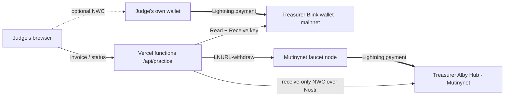

# CircleSats — presentation

**Save together. Pay instantly. Rotate fairly. Track every sat.**
Dakar Bitcoin Hack 2026 · live demo: [circlesats-two.vercel.app](https://circlesats-two.vercel.app/) · code: [github.com/0xNexuz/circlesats](https://github.com/0xNexuz/circlesats)

## 1. The problem

Rotating savings circles (*tontines*, *natt* in Wolof) are a common way people in Senegal and across West Africa save: each member puts in the same amount every week or month, and one member takes the whole pot each turn. They run on trust and memory. The usual pain points are:

- Nobody has one clear record of who has paid this round.
- Late or missing contributions are discovered only when the pot is short.
- Payouts are argued over: was it approved, and was it really sent?
- Members who travel or live abroad cannot easily pay in.

We have not run user interviews; this is the problem as the circles commonly describe it, and the first thing we would validate with real groups.

## 2. The solution

CircleSats keeps a circle's money in its members' own wallets and gives the circle one shared, verifiable record:

1. **Contribute over Lightning.** Each member gets a unique Lightning invoice for the round. A payment counts only when the treasurer's wallet confirms it; the receipt shows the payment hash and preimage, so anyone can check it.
2. **See the round at a glance.** Paid, due and overdue members, the target, and the deadline.
3. **Approve the payout together.** Every member except the recipient approves; the recipient cannot approve their own payout. Every action goes into an audit trail.
4. **Rotate fairly.** The schedule is fixed in advance, and history is kept across cycles.

CircleSats never holds the pooled funds. The treasurer's wallet holds them, and the app's server only has receive-only access to it.

## 3. Try it (one minute, no sign-up)

Open the demo → **Start guided demo** → **Create demo wallet** → **Get 200 demo sats** → **Go to my contribution** → **Create demo contribution**, then:

- **Have a Lightning wallet?** Scan the real Bitcoin invoice (100 sats, a few cents) or connect your wallet with **Nostr Wallet Connect** and pay in the app. The page detects the payment by itself.
- **No wallet?** **Use free test coins**: the Mutinynet faucet's node pays a Mutinynet invoice over Lightning for you.

Then simulate the other three members, approve, and watch the payout rotate through four rounds. Each visitor gets a private circle, so judges never affect each other.

## 4. How it works

- **Bitcoin / Lightning:** BOLT11 invoices on mainnet (Blink) and Mutinynet (Alby Hub); invoices are decoded and checked for network, amount, hash and expiry before they are stored.
- **Nostr:** Nostr Wallet Connect (NIP-47) links the app to the treasurer's node for receiving, and lets members pay from their own wallet inside the app.
- **Security by design:** receive-only credentials (spending permission is refused at startup), exact invoice/hash/amount matching, unique payment hashes, CSRF-protected sessions, strict Content Security Policy, and no secrets in the browser.

## 5. What is proven today

- **A real Lightning payment through the live demo** on 27 October 2026: the Mutinynet faucet paid a 100-sat invoice issued by the treasurer's Alby Hub, which confirmed it; SHA-256(preimage) equals the payment hash. [Evidence](LIGHTNING_PAYMENT_EVIDENCE.md).
- 45 automated tests, including the four-round savings cycle, provider mismatch and replay cases, and the guest payment paths; browser runs of every payment path.
- **Not yet shown:** a mainnet payment through the demo (it switches on with the treasurer's Blink key), automated payouts, and use by a real circle.

## 6. Impact and what we would measure

The demo circle is four people paying 100 sats a week. For a real pilot we would track: circles and members onboarded, share of contributions paid on time, time from round funded to payout approved, disputes raised, and contributions from members abroad.

## 7. Next iteration

1. Pilot with two or three real circles in Dakar and validate the problem with them.
2. French and Wolof interface, and amounts shown in CFA francs.
3. Verified payouts: pay the recipient from the treasurer's wallet with a spending budget the group approves, and record the proof.
4. Member sign-in with Nostr Wallet Connect instead of access codes.
5. A persistent hosted ledger for real groups (the Node app with durable storage is ready for a single-server deployment).
